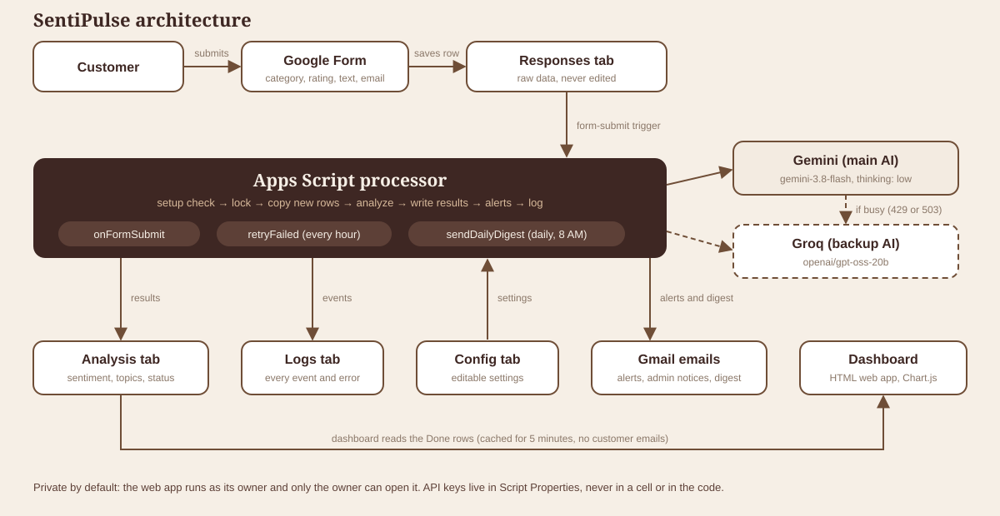

# SentiPulse: AI Customer Feedback Intelligence Dashboard

> From raw feedback to instant insight.

SentiPulse turns customer feedback into decisions automatically. A customer fills in a Google Form, an AI model analyzes the comment within seconds (sentiment, topics, urgency), negative feedback sends an instant email alert, and a brown-and-white coffee-shop dashboard shows trends, top complaints, and word frequency.

Everything runs on Google Forms, Google Sheets, and Google Apps Script, with Gemini as the main AI and Groq as an automatic backup. No servers to manage.

**Demo business:** Kanto Brew Co., a **fictional** specialty coffee roaster and café chain in Metro Manila. All data in this repository is dummy data.

## At a glance

| | |
|---|---|
| Time to analyze one feedback | About 8 seconds |
| Sentiment labels | 4 (Positive, Neutral, Mixed, Negative) with a score from -1 to +1 |
| Topic tags | 14 fixed tags, 1 to 3 per feedback |
| AI providers | 2 (Gemini main, Groq backup) with automatic failover |
| Automatic triggers | 3 (form submit, hourly retry, daily digest) |
| Dashboard | 6 KPI cards, 5 charts, word cloud, urgent panel, searchable table |
| Dummy dataset | 60 backdated feedbacks over 8 weeks, in English and Taglish |
| Built-in self-test | 15 checks, about 20 seconds, changes no data |

---

## Table of contents

1. [Features](#features)
2. [How it works](#how-it-works)
3. [Tech stack](#tech-stack)
4. [Project structure](#project-structure)
5. [Data model](#data-model)
6. [AI analysis](#ai-analysis)
7. [Automation](#automation)
8. [Error handling](#error-handling)
9. [Alerts and daily digest](#alerts-and-daily-digest)
10. [The dashboard](#the-dashboard)
11. [Setup guide](#setup-guide)
12. [Testing](#testing)
13. [Security and privacy](#security-and-privacy)
14. [Limitations](#limitations)
15. [Future improvements](#future-improvements)
16. [Skills demonstrated](#skills-demonstrated)

---

## Features

- **Automatic AI analysis** of every submission: sentiment (Positive, Neutral, Mixed, Negative), a score from -1 to +1, 1 to 3 topic tags from a fixed list of 14, a one-sentence summary, and an urgency flag.
- **Works with Taglish** (English and Filipino mixed), tested with dummy feedback written the way customers really write.
- **Instant email alerts** for negative or urgent feedback, with a clean HTML email (score bar, stars, quote box, button).
- **Daily digest** email every morning at 8 AM (Asia/Manila) with KPIs, a sentiment split, top complaints, and urgent items.
- **Two-AI failover:** Gemini first, Groq automatically when Gemini is busy or rate limited.
- **Never loses feedback:** every row has a status (Pending, Done, Failed), and failed rows are retried automatically.
- **Dashboard** with 6 KPI cards, 5 charts, a word cloud, an urgent panel, and a searchable, sortable feedback table.
- **Date filters:** 7, 30, and 90 days, this month, last month, a month picker, a custom date range, and all time, plus category and sentiment filters.
- **Full audit trail** in a Logs tab, with API keys automatically hidden.
- **Built-in self-test** (15 checks) that runs in about 20 seconds without changing any data.

## How it works



1. A customer submits the **Google Form**. The answer is saved in the **Responses** tab, which is raw data and is never edited.
2. A **form-submit trigger** starts the Apps Script processor.
3. The processor checks the setup, takes a lock (so two runs never collide), copies new rows into the **Analysis** tab as `Pending`, and analyzes them one by one.
4. Each feedback goes to **Gemini**. If Gemini is busy or limited (HTTP 429 or 503), it goes to **Groq**, and Gemini rests for 5 minutes.
5. The AI reply is validated and corrected, then written to the Analysis tab with status `Done`.
6. If the score is at or below the alert threshold (default -0.4) or the feedback is urgent, an **alert email** is sent.
7. Everything important is written to the **Logs** tab.
8. The **dashboard** (an Apps Script web app) reads the Done rows, aggregates them on the server, caches the result for 5 minutes, and draws the charts in the browser.

## Tech stack

| Layer | Technology |
|---|---|
| Input | Google Forms |
| Database | Google Sheets (4 tabs) |
| Backend and automation | Google Apps Script (V8 JavaScript), triggers, LockService, CacheService, PropertiesService, MailApp |
| AI (main) | Gemini API, model `gemini-3.8-flash`, thinking level `low`, JSON output |
| AI (backup) | Groq API (OpenAI-compatible), model `openai/gpt-oss-20b` |
| Dashboard | HtmlService web app, HTML, CSS, vanilla JavaScript, Chart.js |
| Email | Gmail through MailApp, HTML with a plain-text fallback |

## Project structure

```
sentipulse/
├── README.md
├── LICENSE
├── .gitignore
├── src/
│   ├── Config.gs        settings reader and setup validation
│   ├── Logger.gs        Logs tab writer (hides API keys)
│   ├── AI.gs            prompt builder, Gemini call, reply checker, retries
│   ├── Fallback.gs      Groq backup AI and automatic switching
│   ├── Processor.gs     sync, analyze, lock, time guard, alerts per row
│   ├── Alerts.gs        alert, admin, and digest emails
│   ├── Dashboard.gs     web app entry point and dashboard data
│   ├── Setup.gs         creates the triggers
│   ├── SeedData.gs      60 backdated dummy feedbacks and helper functions
│   ├── SelfTest.gs      the 15-check self-test
│   ├── Index.html       dashboard page
│   ├── Styles.html      coffee-shop theme
│   ├── Script.html      filters, loading, KPIs
│   ├── Charts.html      the 5 charts
│   └── Panels.html      word cloud, urgent panel, feedback table
└── docs/
    └── architecture.svg
```

## Data model

### Google Form (4 questions)

| # | Question | Type | Required |
|---|---|---|---|
| 1 | What is your feedback mostly about? | Dropdown: Overall Experience, Product Quality, Customer Service, Delivery, Pricing, Website/App, Other | Yes |
| 2 | How would you rate your overall experience? | Linear scale, 1 to 5 | Yes |
| 3 | Please share your feedback | Paragraph, at least 10 characters | Yes |
| 4 | Email (optional, if you want us to follow up) | Short answer, email validation | No |

### Spreadsheet tabs

| Tab | Purpose |
|---|---|
| **Responses** | Raw Form data. Owned by the Form, never edited. |
| **Analysis** | One row per response with the AI results and status. |
| **Config** | Editable settings (no code changes needed). |
| **Logs** | Audit trail: time, level (INFO, WARN, ERROR, CRITICAL), function, message, details. Trimmed automatically. |

### Analysis columns (A to O)

| Col | Header | Filled by |
|---|---|---|
| A | Response ID (`R-` plus the Responses row number) | Script |
| B | Timestamp | Script |
| C | Category | Script |
| D | Rating | Script |
| E | Feedback | Script |
| F | Sentiment | AI |
| G | Sentiment Score (-1 to +1) | AI |
| H | Topics | AI |
| I | Summary | AI |
| J | Urgent | AI |
| K | Status (Pending, Done, Failed) | Script |
| L | Processed At | Script |
| M | Error | Script |
| N | Retry Count | Script |
| O | Alert Sent (Yes, No, Failed, Skipped) | Script |

### Config settings

| Setting | Default | Meaning |
|---|---|---|
| BUSINESS_NAME | Kanto Brew Co. | Shown in the dashboard and emails |
| ALERT_EMAIL | your email | Where alerts, admin notices, and the digest go |
| ALERT_THRESHOLD | -0.4 | Alert when the score is at or below this |
| AI_PROVIDER | gemini | Main AI |
| AI_MODEL | gemini-3.8-flash | Main model |
| MAX_RETRIES | 3 | Failed attempts allowed per row |
| WORD_FREQ_TOP_N | 30 | Words shown in the word chart |
| CACHE_SECONDS | 300 | Dashboard cache time |
| DIGEST_ENABLED | TRUE | Daily digest on or off |
| TIMEZONE | Asia/Manila | Dates and trigger times |
| FALLBACK_PROVIDER | groq | Backup AI (`groq` or `none`) |
| FALLBACK_MODEL | openai/gpt-oss-20b | Backup model |

## AI analysis

### Output the AI must return

```json
{
  "sentiment": "Positive | Neutral | Negative | Mixed",
  "sentiment_score": -1.0,
  "topics": ["1 to 3 tags from the fixed list"],
  "summary": "one sentence, at most 20 words",
  "urgent": false
}
```

### Rules in the prompt

- **Sentiment:** Positive above +0.25, Neutral from -0.25 to +0.25, Negative below -0.25, Mixed when there is clear praise and a clear complaint in the same message.
- **Topics (fixed list of 14):** Taste and Quality, Freshness, Packaging, Delivery Speed, Order Accuracy, Staff Attitude, Wait Time, Pricing and Value, Promotions, App or Website Bugs, Checkout and Payment, Cleanliness and Ambiance, Refund and Support, Other. A fixed list keeps the topic chart clean, because free-form tags would split the same problem into many names.
- **Urgent:** food safety or health concerns, payment problems (double charge), threats to leave or take legal or public action, abusive staff behavior, or a repeated unresolved issue.
- **The rating is only a hint.** The text decides the sentiment, so a 4-star review with a complaint can still be Mixed.
- **Prompt-injection guard:** the feedback is wrapped in markers, and the AI is told it is data only and that it must never follow instructions inside it.

### Validation of every AI reply

| Check | If it fails |
|---|---|
| Reply contains a JSON object (code fences are stripped) | Error, retry |
| Sentiment is one of the 4 labels (case-insensitive) | Error, retry |
| Score is a number | Error, retry |
| Score outside -1 to 1 | Clamped, WARN logged |
| Topic not in the list | Replaced with Other, WARN logged |
| No topics | Other, WARN logged |
| More than 3 topics | First 3 kept |
| Summary over 200 characters | Truncated |
| Urgent not true or false | Defaults to false, WARN logged |

### Speed and failover

- Thinking level is set to `low` for Gemini. In testing, one analysis took about **8 seconds** (instead of minutes with the default thinking level).
- Gemini gets 3 attempts with 2 and 4 second waits. Wrong keys or model names (HTTP 400, 401, 403, 404) are treated as **fatal**, and the run stops with an alert, so a broken setup is never hidden by the backup.
- On 429, 503, network errors, or messy replies, the feedback goes to **Groq** (2 attempts). After a limit error, Gemini rests for 5 minutes so the next rows go straight to Groq.
- If both AIs are limited, the run **pauses** and the rows stay waiting. A temporary limit never marks a row as Failed.

## Automation

| Trigger | Function | When |
|---|---|---|
| Spreadsheet, on form submit | `onFormSubmit` | Every new response |
| Time-driven | `retryFailed` | Every hour: retries Failed rows and catches anything missed |
| Time-driven | `sendDailyDigest` | Every day around 8 AM (Asia/Manila) |

Triggers are created by code (`setupTriggers`), which removes old copies first, so setup is repeatable.

**Safety mechanisms**

- **LockService:** one run at a time. If a run cannot get the lock within 30 seconds, it is skipped and the next run picks up the waiting rows.
- **Time guard:** a run stops after 4.5 minutes or 20 rows (Apps Script's limit is 6 minutes) and continues on the next run.
- **Idempotency:** a Response ID that already exists is never processed or alerted twice.
- **Pacing:** 5 seconds between AI calls to stay inside free-tier limits.

## Error handling

| Situation | Handling | Logged as |
|---|---|---|
| API key or model missing or wrong | Run stops, rows stay Pending, one admin email per hour | CRITICAL |
| Tab missing, header changed, or ALERT_EMAIL invalid | Setup check stops the run before any data is touched | CRITICAL |
| Gemini busy or rate limited (429, 503) | Switch to the Groq backup for 5 minutes | WARN |
| Both AIs limited | Run pauses, rows stay waiting, no email flood | WARN |
| Network error or messy AI reply | Retry with backoff, then Failed (retried hourly) | WARN, then ERROR |
| AI reply with a wrong value | Corrected (clamp, replace, default) | WARN |
| Feedback blocked by the AI safety filter | Failed, not retried | ERROR |
| Several rows permanently failed | One summary email per run, not one per row | ERROR |
| Alert email fails to send | Alert Sent = Failed, retried automatically on later runs | ERROR |
| Feedback older than 48 hours | Alert Sent = Skipped (no old alerts after loading history) | INFO |
| Two submissions at the same time | Lock: one run at a time, no overwritten rows | INFO or WARN |
| Admin alert repeated | Same subject sent at most once per hour | none |
| Dashboard data fails | Friendly message with a Retry button, ERROR logged | ERROR |
| Period with no data | Empty state, no broken charts | none |
| Cache failure | Falls back to reading the sheet directly | WARN |

## Alerts and daily digest

**Alert rule:** send when the Sentiment Score is at or below `ALERT_THRESHOLD` **or** Urgent is TRUE.

| Email | Content |
|---|---|
| **Alert** | Orange banner (red for urgent), category and stars, sentiment badge and score bar, AI summary as the headline, the customer's text in a quote box, topic chips, response ID and time, customer email if given, and a button to the dashboard |
| **Admin notice** | Gray banner with the problem and a link to the spreadsheet |
| **Daily digest** | KPI cards, a colored sentiment split bar, top complaint topics with bars, urgent items, waiting and failed counts. It sends nothing when there was no new feedback. |

Emails use table layouts and inline styles, so they render in Gmail, Outlook, and phone apps.

## The dashboard

An Apps Script web app (`doGet`) styled as a brown-and-white coffee-shop dashboard.

| Panel | What it shows |
|---|---|
| KPI cards | Responses, average rating, average sentiment, percent negative, urgent items, pipeline health, each compared with the previous period |
| Sentiment over time | Stacked bars per day, week, or month (chosen automatically from the period length) plus an average-score line |
| Sentiment split | Donut chart with the total in the center |
| Top complaints | Topics counted from Negative and Mixed feedback |
| Category by sentiment | Stacked horizontal bars |
| Rating distribution | 1 to 5 stars |
| What customers talk about | Word cloud and a most-mentioned list. Click a word to filter the table. |
| Urgent items | Cards for urgent feedback |
| Recent feedback | Search, sortable columns, click a row to read the full text |

**Date filters:** 7, 30, and 90 days, this month, last month, a month picker, a custom range, and all time. For a month in progress, the comparison uses the same number of days of the previous month. All dates use the Config timezone, and impossible dates or backwards ranges are corrected on the server.

**Performance and safety**

- The server aggregates the data and sends a small summary to the browser (plus the latest 100 feedbacks).
- Results are cached for 5 minutes, and the cache is cleared when new feedback is analyzed.
- Customer emails never leave the server.
- All customer text is HTML-escaped before it is shown.
- Loading skeletons, an empty state, and an error state with a Retry button.

## Setup guide

1. **Create the Form** with the 4 questions above.
2. **Link it to a spreadsheet** (Responses tab, Create a new spreadsheet). Rename the tab to `Responses`, then add the **Analysis**, **Config**, and **Logs** tabs with the headers from the data model section. Add dropdown validation for Status (Pending, Done, Failed) and Sentiment (Positive, Neutral, Negative, Mixed).
3. **Open Extensions, then Apps Script** and create the files from `src/`.
4. **Add the keys** in Project Settings, then Script Properties: `GEMINI_API_KEY` (from Google AI Studio) and, optionally, `GROQ_API_KEY`.
5. **Fill in the Config tab** (at least `ALERT_EMAIL`, `AI_MODEL`, and the fallback settings).
6. **Run `testConfig`, then `testGeminiConnection`** and approve the permissions.
7. **Run `setupTriggers`** to create the 3 triggers.
8. **Deploy** as a Web app: Execute as Me, access Only myself.
9. *(Optional)* **Run `seedTestData`**, then `processNow` until nothing is Pending, to load the 60 dummy feedbacks.
10. **Run `runSelfTests`** and check that everything passes.

## Testing

- **`runSelfTests`** runs 15 checks in about 20 seconds without changing data or sending email: setup, triggers, keys, email quota, the AI reply checker, alert rules, dashboard filter validation, HTML escaping, key hiding in logs, dashboard data, empty periods, duplicate IDs, incomplete Done rows, and stuck rows.
- **Manual tests:** `testAnalyze`, `testFallback`, `testFailover` (simulates a Gemini outage), `testAlertEmail`, `testDigest`, and `testDashboardData`.
- **Stress tests:** a missing API key, a damaged header, a missing tab, an invalid alert address (then recovery), five simultaneous submissions, and a disabled digest.

## Security and privacy

- API keys are stored only in Script Properties, never in a cell or in the code, and the logger hides anything that looks like a Google or Groq key.
- Customer emails are optional and appear only in alert emails, never on the dashboard.
- Customer text is escaped before display, and the AI prompt treats it as data only.
- **Apps Script lets a web page call any function whose name does not end with an underscore**, and it runs as the owner. For that reason the live system is deployed **private** (Execute as Me, access Only myself). A public demo should be a separate copy with no keys, no triggers, and no email address.
- Feedback text is sent to the AI providers. Check their data terms before using real customer data.

## Limitations

- Free AI tiers have request and token limits that change over time. Check your own limits in each provider's console.
- Apps Script runs have a time limit of about 6 minutes, and Gmail has a daily sending limit (lower on free accounts).
- Sentiment comes from AI and can be wrong. Scores from Gemini and Groq can differ slightly, and the Analysis tab does not yet record which AI analyzed each row (the Logs tab does).
- Google Sheets is great for a project of this size, but is not meant for hundreds of thousands of rows.
- Word frequency uses a simple stopword list for English and Filipino.

## Future improvements

- Record the AI model used per row.
- Branch-level comparison and a weekly PDF report.
- Telegram or Slack alerts.
- Trend anomaly detection, for example a sudden spike in delivery complaints.
- Issue tracking (mark feedback as resolved) and CSV export from the dashboard.
- Language detection and translation for more languages.

## Skills demonstrated

Workflow automation, event-driven triggers, REST API integration, prompt engineering with structured JSON output, failover design, data modeling, defensive programming and error handling, server-side aggregation and caching, dashboard and UI design, email design, and technical documentation.

## Author

Mary Ann Gumafelix

## License

MIT. See [LICENSE](LICENSE).
